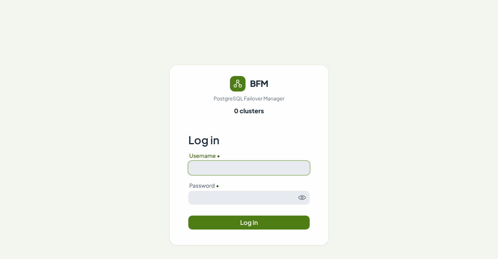
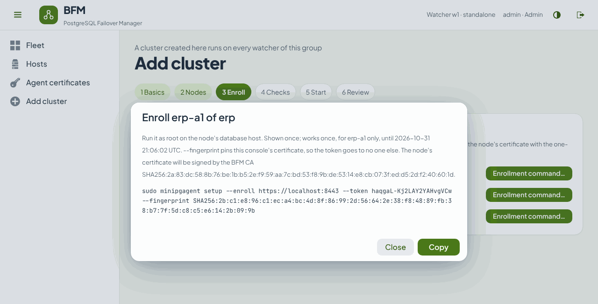
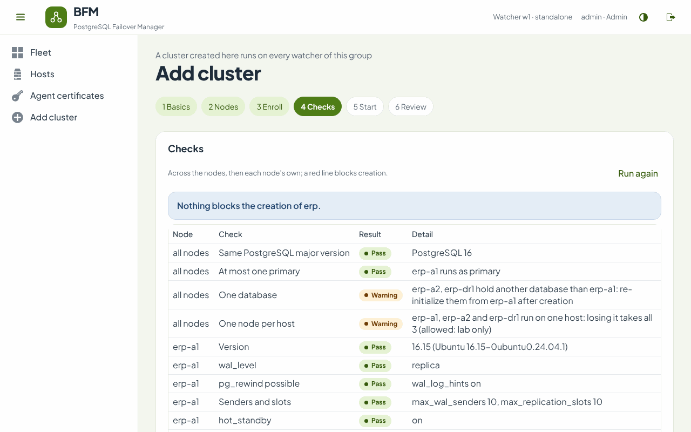

# Installing BFM from the RPM packages

*English · [Türkçe](install-rpm.tr.md)*

Rocky Linux / RHEL 8 and 9. This guide takes you from two RPM files to a running cluster with automatic
failover, using the setup wizards. Every step has a manual equivalent in [install.md](install.md); the
console itself is described in the [user guide](user-guide.md).

| Package | Install it on | What it runs |
| --- | --- | --- |
| `bfm-watcher-<version>.noarch.rpm` | the watcher host (one, or three for Raft) | `bfm-watcher.service`: failover decisions, web console, REST API |
| `minipgagent-<version>.noarch.rpm` | every PostgreSQL server | `minipgagent@<instance>.service`: one agent per PostgreSQL instance |

The watcher should run on its own host (or hosts), not on a database server: it must see a database host fail
from the outside.

---

## 1. Before you start

- [ ] **PostgreSQL 13 or newer**, the same major version on every node of a cluster. One node holds the data;
      the others can be empty (a fresh `initdb`) or already streaming from it — the console's *Build* start
      copies the data to them with `pg_basebackup`. A fresh `initdb` that is running is a primary of its own:
      stop PostgreSQL on those nodes before you create the cluster ([step 5](#5-create-the-cluster)), or the
      checks refuse several primaries.
- [ ] **Java 21.** The packages require `java-21-headless`; `dnf` installs it from AppStream (Rocky 8.9+ / 9.3+).
- [ ] **Clocks in sync** on every host (chrony): leases and the console's times depend on them.
- [ ] **Node names chosen**: short, lowercase, unique — `erp-a1`, `erp-a2`, `erp-dr1`. A node's name becomes its
      certificate's name and its replication slot (`erp-a1` → `erp_a1`).
- [ ] **A free VIP** per data center on the same L2 segment as the nodes that may hold it (optional: a cluster can
      run without one).
- [ ] **Ports open** between the hosts:

| From | To | Port | What for |
| --- | --- | --- | --- |
| operators, scripts | watcher | 8443/tcp | console and REST API |
| database hosts | watcher | 8443/tcp | enrollment (once per node) |
| watcher(s) | every database host | 8008/tcp (one per agent instance) | agent API, mutual TLS |
| database hosts | database hosts | 5432/tcp | replication, `pg_basebackup`, `pg_rewind` |
| watcher | watcher | 9870/tcp | Raft, only with three watchers |

Every port can be changed: see [Ports](#ports).

PostgreSQL itself needs what streaming replication always needs — `wal_level = replica`, `listen_addresses`
that the other nodes can reach (a fresh install listens on localhost only), a replication role, `pg_hba.conf`
entries for every node — plus `wal_log_hints = on` (or data checksums) so a former primary can come back with
`pg_rewind`. You do not have to get this right beforehand: `minipgagent setup` checks each item and offers the fix (see [step 4](#4-install-the-agent-on-every-database-host)). [install.md §2](install.md#2-prepare-postgresql)
explains each setting.

---

## 2. Install the watcher

On the watcher host, as root:

```bash
dnf install ./bfm-watcher-*.noarch.rpm
```

```bash
bfm-watcher setup
```

The wizard asks:

| Question | Default | What to answer |
| --- | --- | --- |
| Watcher id | `w1` | `w1` (with three watchers: `w1`, `w2`, `w3`) |
| Data directory | `/var/lib/bfm-watcher` | keep it |
| Time zone for the console and mails | the host's | e.g. `Europe/Istanbul` |
| Console port | `8443` | keep it, or see [Ports](#ports) |
| Names and addresses operators use for the console | the host's names and addresses | every name typed in a browser, e.g. `bfm.example.com,10.0.9.1`; they go into the console's certificate |
| First admin: user name, password | `admin` | a password of 8 characters or more |
| Certificates | `ca` | `ca`: the watcher keeps a CA and database hosts enroll with one-time tokens (recommended). `files`: you bring stores made with `bfm-make-certs` |
| Raft peers | empty | empty for one watcher; for three see [Three watchers](#7-three-watchers-raft) |

It then shows what it will write and asks once more:

```
 5 · Review
   This will:
     write   /etc/bfm/watcher.yml   (watcher w1, console on port 8443)
     write   /etc/bfm/watcher.env   (the console key store's password)
     create  a CA; /etc/bfm/w1.p12 for this watcher (bfm.example.com,10.0.9.1)
     write   /etc/bfm/ca.p12   (the CA every watcher and agent trusts)
     write   /var/lib/bfm-watcher/ca-import.p12   (moves into the shared state on the first start)
     create  /var/lib/bfm-watcher/secret.key   (encrypts stored passwords; back it up)
     run     systemctl enable --now bfm-watcher

 6 · Done
   Console: https://bfm.example.com:8443   user admin
   Its certificate: SHA256:7e:ed:52:…
```

Open the port and check the service:

```bash
firewall-cmd --permanent --add-port=8443/tcp && firewall-cmd --reload
```

```bash
systemctl status bfm-watcher
```

```bash
journalctl -u bfm-watcher -f
```

**Back up `/var/lib/bfm-watcher/secret.key` now.** It encrypts the CA's key and the SMTP password kept in the
watcher's state; without it the watcher can no longer enroll agents.

### Trust the console's certificate

The console's certificate is signed by the new BFM CA, so browsers warn until the CA is trusted. Save the CA
certificate and add it to the operators' trust store (or your organization's):

```bash
curl -sk -u admin https://bfm.example.com:8443/api/v1/ca | python3 -c 'import sys,json; print(json.load(sys.stdin)["certificate"], end="")' > bfm-ca.crt
```

On a Rocky / RHEL workstation: `cp bfm-ca.crt /etc/pki/ca-trust/source/anchors/ && update-ca-trust`.

### Sign in

Open `https://bfm.example.com:8443` and sign in as the admin. A new watcher has no cluster yet; the Fleet page
offers *Add cluster*.

The console speaks English, Turkish and Arabic (laid out right to left). It follows the browser's language; the
globe in the header (or the links under the sign-in form) switches it, and the browser remembers the choice for a
year. Events, mails and the REST API stay in English, so they read the same for everyone.



---

## 3. Users

`bfm-watcher setup` creates the first admin. Further users go into `/etc/bfm/watcher.yml`, with a bcrypt hash:

```bash
bfm-watcher hash-password
```

```yaml
bfm:
  users:
    - name: admin
      password-hash: "{bcrypt}$2a$10$…"
      role: ADMIN
    - name: oncall
      password-hash: "{bcrypt}$2a$10$…"
      role: VIEWER
```

`ADMIN` operates (switchover, rejoin, re-initialize, the cluster switches, adding clusters and nodes, settings);
`VIEWER` only looks. Restart the watcher after editing: `systemctl restart bfm-watcher` (wait until no operation
is running).

---

## 4. Install the agent on every database host

### 4.1 Get an enrollment command

In the console, *Add cluster* walks through the cluster's name, environment and failover rules, then its nodes
(name, agent address, PostgreSQL address and port, data center). Step 3, *Enroll*, gives one command per node.
The [user guide](user-guide.md#adding-a-cluster) shows each step.



- The **agent address** is how the watcher reaches the agent: `https://<host>:8008`. The host goes into the
  node's certificate, so use the name or address the watcher really uses.
- The **PostgreSQL address** is the node's own address, never the VIP.
- A command works **once**, for **that node only**, for **30 minutes**. *Enrollment command…* makes a new one.
- `--fingerprint` pins the console's certificate: the token is sent nowhere else, even before the CA is trusted.

For a cluster already defined in `watcher.yml`, the same commands are on the *Agent certificates* page.

### 4.2 Run it

On the database host, as root:

```bash
dnf install ./minipgagent-*.noarch.rpm
```

```bash
sudo minipgagent setup --enroll https://bfm.example.com:8443 --token 7Q2…Kx --fingerprint SHA256:7e:ed:52:…
```

The wizard:

1. **Finds PostgreSQL** on the host: running servers, `postmaster.pid`, the PGDG and Debian locations. With
   several instances it asks which one (or give `--data /var/lib/pgsql/16/data`).
2. **Enrolls**: makes the node's key, sends the token and a certificate request, receives the certificate and
   the cluster's settings.
3. **Network**: the agent port (proposed from the agent address given in the console; it must be free on the
   host) and the VIP with its interface and prefix, checked against the host's subnets and with `arping -D`.
   Then a **live neighbour for the duplicate-address self-test**, proposed from the default gateway: `arping -D`
   must see it, or the network hides duplicates (some cloud networks do) and the agent will keep the VIP down
   rather than trust a check that sees nothing. Answer `none` only for a node without a VIP.
4. **Checks PostgreSQL** and offers each fix separately: version, the cluster's database, `wal_level`,
   `wal_log_hints`, senders and slots, `hot_standby`, `listen_addresses`, `wal_receiver_timeout`, the replication
   role (on a primary it
   creates it with the password you give, which also goes into `.pgpass`, and grants it the functions
   `pg_rewind` needs: the agent rewinds as this role, no superuser logs in over the network), `pg_hba.conf`
   entries for every node — this one included, because the file is copied with the data when another node is
   built from it — and room for a re-initialize. It never restarts PostgreSQL: a setting that needs a restart is
   written and reported with the command to restart it.
5. **Shows every change** and asks once.
6. **Applies**: `/etc/bfm/minipgagent/<instance>/` (settings, the node's certificate, the CA, the watchers whose
   certificates may call the agent), the sudo rule for the VIP and its self-test (checked with `visudo` first), the `.pgpass` line, disables the PostgreSQL service (PostgreSQL keeps
   running; from now on the agent starts and stops it) and starts `minipgagent@<instance>`.

A run looks like this (shortened; the values are an example):

```
 2 · Join a cluster
   Creating this node's key (RSA 3072) and asking https://bfm.example.com:8443 to certify it…
   ✔ watcher https://bfm.example.com:8443 · fingerprint matches
   This instance becomes node erp-a1 of cluster erp (PRODUCTION), data center DC1.

 4 · PostgreSQL readiness
   ✔ Version: 16.4
   ✔ Database: system identifier 7702933269235768432 (the cluster has none recorded yet)
   ✔ wal_level: replica
   ✔ pg_rewind possible: wal_log_hints on
   ✔ Senders and slots: max_wal_senders 10, max_replication_slots 10
   ✔ hot_standby: on
   ✔ listen_addresses: *
   ✔ Replication role: replicator can log in and replicate
   ✔ pg_rewind role: replicator may run pg_rewind
   ✔ pg_hba.conf: every node may replicate
   ✔ Room for a re-initialize: 220 GB free next to 37 GB of databases
```

When setup reports settings that take effect after a restart (`listen_addresses`, `wal_log_hints` on a fresh
install), restart PostgreSQL before you create the cluster, with the command it prints, for example:

```bash
runuser -u postgres -- /usr/pgsql-16/bin/pg_ctl -D /var/lib/pgsql/16/data restart -m fast -l /var/lib/pgsql/16/data/log/restart.log
```

On the nodes that *Build* will copy the data to, stop PostgreSQL instead (`… pg_ctl -D … stop -m fast`).

Open the agent port:

```bash
firewall-cmd --permanent --add-port=8008/tcp && firewall-cmd --reload
```

Useful options:

| Option | What it does |
| --- | --- |
| `--dry-run` | shows every change, makes none |
| `--answers FILE` | answers every question from a properties file, for Ansible and the like (keys: `agent.port`, `vip.address`, `vip.interface`, `vip.prefix`, `vip.dad.probe`, `replication.user`, `replication.password`, `instance`, `fix.<check>`, `proceed`) |
| `--yes` | answers yes to every confirmation |
| `--data DIR` | the data directory, when the host has several instances |
| `--instance NAME` | the agent instance name (default: the cluster's name) |
| `--bundle DIR` | with an offline CA: the node's `NAME.p12`, `NAME.pass`, `ca.p12`, `ca.pass` from `bfm-make-certs`, instead of a token |

**Several clusters on one server.** Run setup once per PostgreSQL instance, each with its own enrollment
command. Each instance gets its own agent (`minipgagent@erp`, `minipgagent@crm`), its own port (8008, 8009, …)
and its own directory; the console's *Hosts* page shows what runs where. Two nodes of the **same** cluster on one
server fail the console's checks (losing the server would take both).

---

## 5. Create the cluster

Back in the console, *Enroll* shows each node as enrolled once its agent answers. Then:

- **Checks**: across the nodes (every agent answers and belongs to no other cluster, one PostgreSQL major version,
  at most one primary, one database, one node per host, clocks) and each node's own settings. A red line blocks
  creation; yellow lines say what to do after it. *All run as primary* means PostgreSQL still runs on nodes that
  *Build* will copy the data to: stop it there and run the checks again.
- **Start**: *Adopt* when one node already runs as primary and the others stream from it (nothing is
  restarted), or *Build*: the chosen node starts as primary and every other node is re-initialized from it.
- **Review**: type the cluster's name and create it. The console opens the Operations page, where the build
  runs step by step.



---

## 6. Check that it works

On the console, the cluster's Overview should say **Healthy**: the primary, every replica *Streaming*, the VIP on
the primary.

On each database host:

```bash
systemctl status minipgagent@erp
```

```bash
journalctl -u minipgagent@erp -n 50
```

Then try a switchover on the *Switchover* page (it checks first, and asks you to type the cluster's name), and
switch back. On a test cluster, also stop the primary's host and watch the automatic failover; the
[user guide](user-guide.md#when-the-primary-fails) shows what the console says while it happens.

**Mail.** Set the SMTP server, recipients and rules on the *Notifications* page and send a test mail.

**How long a failover takes.** The failover itself (epoch, promote, record, re-point) takes about 10 s, and
finding the primary lost takes three polls, about 6–15 s. When the primary's host is cut off from the network
rather than down, no TCP reset reaches the replicas: they keep reporting the stream until PostgreSQL's
`wal_receiver_timeout` ends it, and while one does the failover waits (the watcher looks again at every poll).
`minipgagent setup` therefore proposes `wal_receiver_timeout = 10s` instead of the default 60 s. Measured on cloud
servers for a network cut: 37 s with 10 s; 62–105 s with the default 60 s before the watcher looked again at every
poll.

---

## 7. Three watchers (Raft)

One watcher is a single point of decision: while it is down nothing fails over. Three watchers form a Raft group,
and the leader acts for every cluster; when it goes, another one takes over within seconds.

1. On `w1`, run `bfm-watcher setup` with the peers, this watcher included:
   `w1=10.0.9.1,w2=10.0.9.2,w3=10.0.9.3`. It creates the certificates of all three and prints, for `w2` and
   `w3`, the files to copy: `w2.p12`, `w2.pass`, `ca.p12`, `ca.pass` and `secret.key`.
2. On `w2` and `w3`: install the RPM; put `w2.p12`, `w2.pass`, `ca.p12`, `ca.pass` in `/etc/bfm/` and
   `secret.key` in `/var/lib/bfm-watcher/` (owner `bfm`, mode 600); then run `bfm-watcher setup` with
   *Certificates* `files`, the same peers and its own id.
3. Open 9870/tcp between the watchers.
4. On every database host, add the new watchers to `tls.allowed.clients` in the agent's `agent.properties`
   (`tls.allowed.clients=w1,w2,w3`) and restart the agent (`systemctl restart minipgagent@<instance>`;
   PostgreSQL keeps running). An agent enrolled while there was one watcher only accepts `w1`'s certificate and
   refuses the others with 403. Agents enrolled after this step get all three ids.

Every watcher runs every cluster; the header shows *Watchers 3/3 · leader w1*. The wizards and operations run on
the leader; a follower's console links to it. With three watchers, turn on **self-fencing** for each cluster
(*Add cluster*, step 1): a primary cut off from every watcher then stops itself after its lease, which rules out
a split brain.

---

## 8. Upgrading

```bash
dnf upgrade ./bfm-watcher-*.noarch.rpm
```

```bash
dnf upgrade ./minipgagent-*.noarch.rpm
```

Settings under `/etc/bfm` are kept. **An upgrade does not restart the services** — a restart would interrupt a
running `pg_basebackup`, `pg_rewind` or switchover. Restart them when nothing runs (the Operations page shows it):

```bash
systemctl restart bfm-watcher
```

```bash
systemctl restart minipgagent@erp
```

Agents one host at a time; PostgreSQL keeps running while its agent restarts. With three watchers, restart one
watcher at a time.

---

## 9. Removing

- **A node** from a cluster made in the console: its menu on the Overview → *Remove from the cluster…*.
- **A whole cluster**: Overview → *Cluster ▾* → *Detach…*. Failover is paused, the primary gets a last lease
  that never fences, and every agent forgets the cluster. PostgreSQL keeps running everywhere.
- **An agent** from a host, afterwards:

```bash
minipgagent remove erp
```

  It stops and disables `minipgagent@erp` and sets its settings and sudo rule aside; PostgreSQL keeps running.
  Give PostgreSQL back to its own service if you will run it without BFM:

```bash
systemctl enable postgresql-16
```

- **The packages**: `dnf remove minipgagent` / `dnf remove bfm-watcher`. Settings and state under `/etc/bfm` and
  `/var/lib` are kept.

---

## Files and services

| Path | On | What it is |
| --- | --- | --- |
| `/etc/bfm/watcher.yml` | watcher | settings: users, clusters from file, Raft, TLS |
| `/etc/bfm/watcher.env` | watcher | the console key store's password |
| `/etc/bfm/w1.p12`, `ca.p12` | watcher | the watcher's certificate (console and agent client), the CA |
| `/var/lib/bfm-watcher/` | watcher | state, event logs, Raft log, **`secret.key`** |
| `/etc/bfm/minipgagent/<instance>/agent.properties` | database host | the agent instance's settings |
| `/etc/bfm/minipgagent/<instance>/node.p12`, `ca.p12` | database host | the node's certificate, the CA |
| `/etc/sudoers.d/minipgagent-<instance>` | database host | what the agent may run as root: the VIP commands |
| `/var/lib/minipgagent/<instance>/` | database host | the agent's state: epoch, lease, binding to its cluster |
| `bfm-watcher.service` | watcher | runs as user `bfm` |
| `minipgagent@<instance>.service` | database host | runs as user `postgres` |

Back up `/etc/bfm/` on every host and `/var/lib/bfm-watcher/secret.key`.

## Ports

| Port | Default | Where to change it |
| --- | --- | --- |
| Console and REST API | 8443 | `server.port` in `watcher.yml`; with three watchers also `bfm.raft.peers[].url` |
| Raft between watchers | 9870 | `bfm.raft.peers[].port` in `watcher.yml` (the same list on every watcher) |
| Agent API | 8008 | `listen.port` in `agent.properties`, **and** the port in the node's agent address on the watcher side |
| PostgreSQL | 5432 | `pg.port` in `agent.properties` and the node's PostgreSQL port on the watcher side; the agent starts PostgreSQL with `-p` on that port |

The certificates hold names and addresses, not ports, so a port change needs no new certificate. Open the new
port in the firewall and restart the service.

## When something goes wrong

| What you see | What to do |
| --- | --- |
| `setup` stops at *TLS with the watcher failed: the watcher presents …, not the fingerprint the console …* | The command was made by another console, or something sits in between. Copy the command again from the console you trust |
| `setup` stops at *the watcher refused: this token has expired* (or *was already used*) | Make a new command (*Enrollment command…*); each works once, for 30 minutes |
| `setup` stops at *port 8008 is in use on this host* | Another agent instance uses it: answer another port and change the node's agent address to match (the wizard's Nodes step) |
| The node stays *Waiting for the agent* in the wizard | The agent does not answer on the agent address: `systemctl status minipgagent@<instance>`, the firewall (8008/tcp), the address in the wizard |
| A check fails on `pg_hba.conf` or the replication role | Run setup again and accept the fix, or edit `pg_hba.conf` and reload PostgreSQL |
| The browser warns about the certificate | Trust the BFM CA ([step 2](#trust-the-consoles-certificate)), and use a name given to *Names and addresses* |
| The node shows *Wrong identity* | The agent address reaches another node's or another cluster's agent: fix the address |
| A node's error says *certificate CN=w2 may not call this agent* | The agent was enrolled before that watcher existed: add it to `tls.allowed.clients` in `agent.properties` and restart the agent ([step 7](#7-three-watchers-raft)) |
| A node's error says *the duplicate address check cannot see other hosts* | `arping -D` gets no answer from `vip.dad.probe` (the gateway) on this network, so a VIP held elsewhere would look free; the agent keeps the VIP down. Check the address and interface; on a network that never answers ARP probes protect the VIP another way and set `vip.dad.enabled=false` |
| The checks say *… all run as primary* | PostgreSQL runs on nodes that *Build* will copy the data to: stop it there (`runuser -u postgres -- pg_ctl -D <data> stop -m fast`) and run the checks again |
| After a switchover or failover a replica stays *Not streaming*; the new primary's log says *no pg_hba.conf entry for replication connection from host "<the replica's address>"* | Agents set up before version 0.1.0-3 added `pg_hba.conf` lines for the other nodes only, and the file travels with the data: add the node's own two lines on every node and reload |
| A rejoin fails: *pg_rewind … no pg_hba.conf entry for host …, user "postgres"* | Agents set up before version 0.1.0-3 rewind as `postgres`: set `rewind.user=replicator` in `agent.properties`, grant the role the functions `pg_rewind` needs on the primary ([install.md §2.2](install.md#22-roles)), restart the agent, then *Re-initialize* the node once |
| A node's error says *duplicate address self-test failed: … sudo* | The sudo rule lacks the self-test line: run setup again, or add `/usr/sbin/arping -D -c 2 -w 3 -I <iface> <probe>` to `/etc/sudoers.d/minipgagent-<instance>` |

More cases: [install.md §12](install.md#12-troubleshooting).
