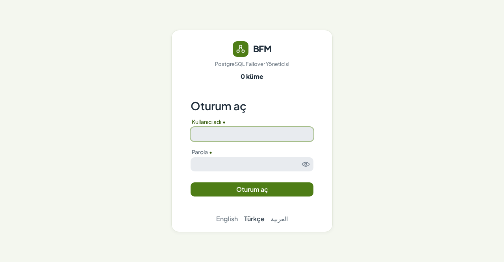
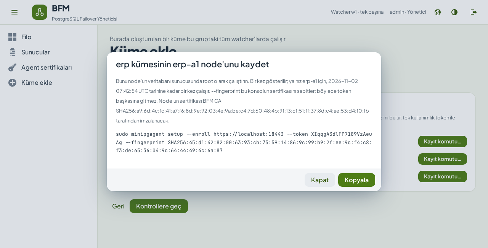
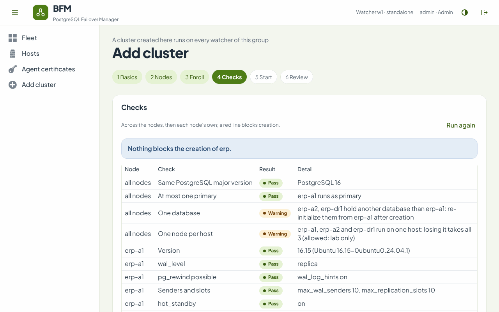

# BFM'i RPM paketlerinden kurmak

*[English](install-rpm.md) · Türkçe*

Rocky Linux / RHEL 8 ve 9. Bu rehber, iki RPM dosyasından otomatik failover yapan, çalışan bir kümeye kadar kurulum
sihirbazlarıyla ilerler. Her adımın elle yapılan karşılığı [install.md](install.md) içindedir (İngilizce); konsolun
kendisi [kullanıcı rehberinde](user-guide.md) anlatılır.

| Paket | Nereye kurulur | Ne çalıştırır |
| --- | --- | --- |
| `bfm-watcher-<sürüm>.noarch.rpm` | watcher sunucusu (bir tane, Raft için üç) | `bfm-watcher.service`: failover kararları, web konsolu, REST API |
| `minipgagent-<sürüm>.noarch.rpm` | her PostgreSQL sunucusu | `minipgagent@<instance>.service`: her PostgreSQL instance'ı için bir agent |

Watcher kendi sunucusunda (veya sunucularında) çalışmalı, bir veritabanı sunucusunda değil: bir veritabanı
sunucusunun çöktüğünü dışarıdan görebilmesi gerekir.

---

## 1. Başlamadan önce

- [ ] **PostgreSQL 13 veya üstü**, bir kümenin tüm node'larında aynı ana sürüm. Veriyi bir node tutar; diğerleri
      boş olabilir (yeni bir `initdb`) ya da ondan zaten streaming yapıyor olabilir — konsolun *Kur* başlatma
      seçeneği veriyi onlara `pg_basebackup` ile kopyalar.
- [ ] **Java 21.** Paketler `java-21-headless` ister; `dnf` onu AppStream'den kurar (Rocky 8.9+ / 9.3+).
- [ ] **Saatler eşit** her sunucuda (chrony): lease'ler ve konsoldaki zamanlar buna dayanır.
- [ ] **Node adları belirlenmiş**: kısa, küçük harf, benzersiz — `erp-a1`, `erp-a2`, `erp-dr1`. Node'un adı
      sertifikasının adı ve replikasyon slot'unun adı olur (`erp-a1` → `erp_a1`).
- [ ] **Boş bir VIP**, her veri merkezi için, onu taşıyabilecek node'larla aynı L2 segmentinde (isteğe bağlı: bir
      küme VIP'siz de çalışabilir).
- [ ] **Sunucular arasında açık portlar**:

| Nereden | Nereye | Port | Ne için |
| --- | --- | --- | --- |
| operatörler, betikler | watcher | 8443/tcp | konsol ve REST API |
| veritabanı sunucuları | watcher | 8443/tcp | kayıt (enrollment, node başına bir kez) |
| watcher(lar) | her veritabanı sunucusu | 8008/tcp (agent instance'ı başına bir tane) | agent API'si, karşılıklı TLS |
| veritabanı sunucuları | veritabanı sunucuları | 5432/tcp | replikasyon, `pg_basebackup`, `pg_rewind` |
| watcher | watcher | 9870/tcp | Raft, yalnızca üç watcher ile |

Her port değiştirilebilir: bkz. [Portlar](#portlar).

PostgreSQL'in kendisi, streaming replikasyonun her zaman istediğini ister — `wal_level = replica`, bir replikasyon
rolü, diğer node'lar için `pg_hba.conf` kayıtları — ve eski bir primary'nin `pg_rewind` ile geri dönebilmesi için
`wal_log_hints = on` (veya data checksums). Bunları önceden ayarlamanız gerekmez: `minipgagent setup` her birini
kontrol eder ve düzeltmeyi önerir (bkz. [4. adım](#4-her-veritabanı-sunucusuna-agentı-kurun)).
[install.md §2](install.md#2-prepare-postgresql) her ayarı açıklar.

---

## 2. Watcher'ı kurun

Watcher sunucusunda, root olarak:

```bash
dnf install ./bfm-watcher-*.noarch.rpm
```

```bash
bfm-watcher setup
```

Sihirbaz şunları sorar (sorular İngilizcedir):

| Soru | Varsayılan | Ne cevap verilir |
| --- | --- | --- |
| Watcher id | `w1` | `w1` (üç watcher ile: `w1`, `w2`, `w3`) |
| Data directory | `/var/lib/bfm-watcher` | olduğu gibi bırakın |
| Time zone for the console and mails | sunucununki | ör. `Europe/Istanbul` |
| Console port | `8443` | olduğu gibi bırakın veya bkz. [Portlar](#portlar) |
| Names and addresses operators use for the console | sunucunun adları ve adresleri | tarayıcıya yazılan her ad, ör. `bfm.example.com,10.0.9.1`; konsolun sertifikasına girerler |
| First admin: user name, password | `admin` | en az 8 karakterlik bir parola |
| Certificates | `ca` | `ca`: watcher bir CA tutar ve veritabanı sunucuları tek kullanımlık token'larla kaydolur (önerilen). `files`: `bfm-make-certs` ile üretilmiş depoları siz getirirsiniz |
| Raft peers | boş | tek watcher için boş; üç watcher için bkz. [Üç watcher](#7-üç-watcher-raft) |

Ardından ne yazacağını gösterir ve bir kez daha sorar:

```
 5 · Review
   This will:
     write   /etc/bfm/watcher.yml   (watcher w1, console on port 8443)
     write   /etc/bfm/watcher.env   (the console key store's password)
     create  a CA; /etc/bfm/w1.p12 for this watcher (bfm.example.com,10.0.9.1)
     write   /etc/bfm/ca.p12   (the CA every watcher and agent trusts)
     write   /var/lib/bfm-watcher/ca-import.p12   (moves into the shared state on the first start)
     create  /var/lib/bfm-watcher/secret.key   (encrypts stored passwords; back it up)
     run     systemctl enable --now bfm-watcher

 6 · Done
   Console: https://bfm.example.com:8443   user admin
   Its certificate: SHA256:7e:ed:52:…
```

Portu açın ve servisi kontrol edin:

```bash
firewall-cmd --permanent --add-port=8443/tcp && firewall-cmd --reload
```

```bash
systemctl status bfm-watcher
```

```bash
journalctl -u bfm-watcher -f
```

**`/var/lib/bfm-watcher/secret.key` dosyasını şimdi yedekleyin.** Watcher'ın durumunda saklanan CA anahtarını ve
SMTP parolasını şifreler; o olmadan watcher artık agent kaydedemez.

### Konsolun sertifikasına güvenin

Konsolun sertifikası yeni BFM CA'sı tarafından imzalanır, bu yüzden CA güvenilir hale gelene kadar tarayıcılar
uyarır. CA sertifikasını kaydedin ve operatörlerin (veya kurumunuzun) güven deposuna ekleyin:

```bash
curl -sk -u admin https://bfm.example.com:8443/api/v1/ca | python3 -c 'import sys,json; print(json.load(sys.stdin)["certificate"], end="")' > bfm-ca.crt
```

Rocky / RHEL bir iş istasyonunda: `cp bfm-ca.crt /etc/pki/ca-trust/source/anchors/ && update-ca-trust`.

### Oturum açın

`https://bfm.example.com:8443` adresini açın ve admin olarak oturum açın. Yeni bir watcher'da henüz küme yoktur;
*Filo* sayfası *Küme ekle*'yi önerir.



Konsol İngilizce, Türkçe ve Arapça (sağdan sola) kullanılabilir. Tarayıcının diline uyar; üst çubuktaki dünya
simgesi (veya oturum açma formunun altındaki bağlantılar) dili değiştirir ve tarayıcı seçimi bir yıl hatırlar.
Olay kayıtları, e-postalar ve REST API herkes için aynı okunsun diye İngilizce kalır.

---

## 3. Kullanıcılar

İlk admin'i `bfm-watcher setup` oluşturur. Diğer kullanıcılar bcrypt özetiyle `/etc/bfm/watcher.yml` içine girer:

```bash
bfm-watcher hash-password
```

```yaml
bfm:
  users:
    - name: admin
      password-hash: "{bcrypt}$2a$10$…"
      role: ADMIN
    - name: oncall
      password-hash: "{bcrypt}$2a$10$…"
      role: VIEWER
```

`ADMIN` işlem yapar (switchover, yeniden katma, yeniden oluşturma, küme anahtarları, küme ve node ekleme, ayarlar);
`VIEWER` yalnızca bakar. Düzenledikten sonra watcher'ı yeniden başlatın: `systemctl restart bfm-watcher` (çalışan
bir işlem kalmayana kadar bekleyin).

---

## 4. Her veritabanı sunucusuna agent'ı kurun

### 4.1 Bir kayıt komutu alın

Konsolda *Küme ekle*, kümenin adı, ortamı ve failover kuralları üzerinden ilerler, ardından node'larını sorar (ad,
agent adresi, PostgreSQL adresi ve portu, veri merkezi). 3. adım, *Kayıt*, her node için bir komut verir.
[Kullanıcı rehberi](user-guide.md#adding-a-cluster) her adımı gösterir.



- **Agent adresi**, watcher'ın agent'a nasıl ulaştığıdır: `https://<sunucu>:8008`. Sunucu adı node'un sertifikasına
  girer; bu yüzden watcher'ın gerçekten kullandığı adı veya adresi yazın.
- **PostgreSQL adresi**, node'un kendi adresidir, asla VIP değil.
- Bir komut **bir kez**, **yalnızca o node** için, **30 dakika** boyunca çalışır. *Yeni token* yenisini üretir.
- `--fingerprint` konsolun sertifikasını sabitler: token, CA henüz güvenilir olmasa bile başka hiçbir yere
  gönderilmez.

`watcher.yml` içinde zaten tanımlı bir küme için aynı komutlar *Agent sertifikaları* sayfasındadır (*Kayıt
komutu…*).

### 4.2 Komutu çalıştırın

Veritabanı sunucusunda, root olarak:

```bash
dnf install ./minipgagent-*.noarch.rpm
```

```bash
sudo minipgagent setup --enroll https://bfm.example.com:8443 --token 7Q2…Kx --fingerprint SHA256:7e:ed:52:…
```

Sihirbaz (soruları İngilizcedir):

1. **PostgreSQL'i bulur**: çalışan sunucular, `postmaster.pid`, PGDG ve Debian konumları. Birden fazla instance
   varsa hangisi olduğunu sorar (veya `--data /var/lib/pgsql/16/data` verin).
2. **Kaydolur**: node'un anahtarını üretir, token'ı ve bir sertifika isteğini gönderir, sertifikayı ve kümenin
   ayarlarını alır.
3. **Ağ**: agent portu (konsolda verilen agent adresinden önerilir; sunucuda boş olmalı) ve arayüzü ile önek
   uzunluğuyla birlikte VIP; sunucunun alt ağlarına göre ve `arping -D` ile kontrol edilir. Ardından **VIP çakışma
   kontrolünün kendini sınaması için canlı bir komşu** sorulur; varsayılan ağ geçidi önerilir. `arping -D` onu
   görmelidir; göremiyorsa ağ çakışmaları gizliyor demektir (bazı bulut ağları böyledir) ve agent hiçbir şey
   görmeyen bir kontrole güvenmek yerine VIP'i kapalı tutar. `none` cevabını yalnızca VIP'siz bir node için verin.
4. **PostgreSQL'i kontrol eder** ve her düzeltmeyi ayrı ayrı önerir: sürüm, kümenin veritabanı, `wal_level`,
   `wal_log_hints`, sender'lar ve slot'lar, `hot_standby`, replikasyon rolü, diğer node'lar için `pg_hba.conf`
   kayıtları, yeniden oluşturma için yer. PostgreSQL'i asla yeniden başlatmaz: yeniden başlatma gerektiren bir ayar
   yazılır ve bildirilir.
5. **Her değişikliği gösterir** ve bir kez sorar.
6. **Uygular**: `/etc/bfm/minipgagent/<instance>/` (ayarlar, node'un sertifikası, CA, agent'ı çağırabilecek
   watcher'lar), VIP ve kendini sınaması için sudo kuralı (önce `visudo` ile kontrol edilir), `.pgpass` satırı;
   PostgreSQL servisini devre dışı bırakır (PostgreSQL çalışmaya devam eder; bundan sonra onu agent başlatıp
   durdurur) ve `minipgagent@<instance>`'ı başlatır.

Bir çalıştırma şöyle görünür (kısaltılmış; değerler örnektir):

```
 2 · Join a cluster
   Creating this node's key (RSA 3072) and asking https://bfm.example.com:8443 to certify it…
   ✔ watcher https://bfm.example.com:8443 · fingerprint matches
   This instance becomes node erp-a1 of cluster erp (PRODUCTION), data center DC1.

 4 · PostgreSQL readiness
   ✔ Version: 16.4
   ✔ Database: system identifier 7702933269235768432 (the cluster has none recorded yet)
   ✔ wal_level: replica
   ✔ pg_rewind possible: wal_log_hints on
   ✔ Senders and slots: max_wal_senders 10, max_replication_slots 10
   ✔ hot_standby: on
   ✔ Replication role: replicator can log in and replicate
   ✔ pg_hba.conf: every other node may replicate
   ✔ Room for a re-initialize: 220 GB free next to 37 GB of databases
```

Agent portunu açın:

```bash
firewall-cmd --permanent --add-port=8008/tcp && firewall-cmd --reload
```

İşe yarayan seçenekler:

| Seçenek | Ne yapar |
| --- | --- |
| `--dry-run` | her değişikliği gösterir, hiçbirini yapmaz |
| `--answers DOSYA` | her soruyu bir properties dosyasından cevaplar; Ansible ve benzerleri için (anahtarlar: `agent.port`, `vip.address`, `vip.interface`, `vip.prefix`, `vip.dad.probe`, `replication.user`, `replication.password`, `instance`, `fix.<kontrol>`, `proceed`) |
| `--yes` | her onaya evet der |
| `--data DİZİN` | sunucuda birden fazla instance varsa veri dizini |
| `--instance AD` | agent instance'ının adı (varsayılan: kümenin adı) |
| `--bundle DİZİN` | çevrimdışı bir CA ile: token yerine `bfm-make-certs` çıktısındaki node'un `AD.p12`, `AD.pass`, `ca.p12`, `ca.pass` dosyaları |

**Bir sunucuda birden fazla küme.** Setup'ı her PostgreSQL instance'ı için, her biri kendi kayıt komutuyla bir kez
çalıştırın. Her instance kendi agent'ını (`minipgagent@erp`, `minipgagent@crm`), kendi portunu (8008, 8009, …) ve
kendi dizinini alır; konsolun *Sunucular* sayfası neyin nerede çalıştığını gösterir. **Aynı** kümenin iki node'u
tek sunucudaysa konsolun kontrolleri başarısız olur (sunucuyu kaybetmek ikisini birden götürür).

---

## 5. Kümeyi oluşturun

Konsola dönün: *Kayıt* adımı, agent'ı yanıt veren her node'u kayıtlı olarak gösterir. Ardından:

- **Kontroller**: node'lar arası (her agent yanıt veriyor ve başka bir kümeye ait değil, tek PostgreSQL ana sürümü,
  en fazla bir primary, tek veritabanı, her sunucuda bir node, saatler) ve her node'un kendi ayarları. Kırmızı bir
  satır oluşturmayı engeller; sarı satırlar oluşturduktan sonra ne yapılacağını söyler.
- **Başlatma**: bir node zaten primary olarak çalışıyor ve diğerleri ondan streaming yapıyorsa *Benimse* (hiçbir şey
  yeniden başlatılmaz), ya da *Kur*: seçilen node primary olarak başlar ve diğer her node ondan yeniden oluşturulur.
- **Gözden geçirme**: kümenin adını yazın ve oluşturun. Konsol, kurulumun adım adım yürüdüğü *İşlemler* sayfasını
  açar.



---

## 6. Çalıştığını kontrol edin

Konsolda kümenin *Genel bakış* sayfası **Sağlıklı** demelidir: primary, her replica *Streaming*, VIP primary'de.

Her veritabanı sunucusunda:

```bash
systemctl status minipgagent@erp
```

```bash
journalctl -u minipgagent@erp -n 50
```

Ardından *Switchover* sayfasında bir switchover deneyin (önce kontrol eder ve kümenin adını yazmanızı ister) ve geri
alın. Bir test kümesinde primary'nin sunucusunu da durdurup otomatik failover'ı izleyin;
[kullanıcı rehberi](user-guide.md#when-the-primary-fails) bu sırada konsolun ne gösterdiğini anlatır.

**E-posta.** SMTP sunucusunu, alıcıları ve kuralları *Bildirimler* sayfasında ayarlayın ve bir test e-postası
gönderin.

---

## 7. Üç watcher (Raft)

Tek watcher tek bir karar noktasıdır: o kapalıyken hiçbir şey failover yapmaz. Üç watcher bir Raft grubu oluşturur
ve lider her küme için karar verir; lider gidince birkaç saniye içinde bir diğeri devralır.

1. `w1` üzerinde `bfm-watcher setup`'ı, bu watcher dahil eşlerle çalıştırın:
   `w1=10.0.9.1,w2=10.0.9.2,w3=10.0.9.3`. Üçünün de sertifikalarını oluşturur ve `w2` ile `w3` için kopyalanacak
   dosyaları yazar: `w2.p12`, `w2.pass`, `ca.p12`, `ca.pass` ve `secret.key`.
2. `w2` ve `w3` üzerinde: RPM'i kurun; `w2.p12`, `w2.pass`, `ca.p12`, `ca.pass` dosyalarını `/etc/bfm/` içine,
   `secret.key`'i `/var/lib/bfm-watcher/` içine koyun (sahibi `bfm`, izinleri 600); ardından *Certificates* için
   `files`, aynı eşler ve kendi id'siyle `bfm-watcher setup`'ı çalıştırın.
3. Watcher'lar arasında 9870/tcp'yi açın.
4. Her veritabanı sunucusunda yeni watcher'ları agent'ın `agent.properties` dosyasındaki `tls.allowed.clients`
   ayarına ekleyin (`tls.allowed.clients=w1,w2,w3`) ve agent'ı yeniden başlatın
   (`systemctl restart minipgagent@<instance>`; PostgreSQL çalışmaya devam eder). Tek watcher varken kaydolmuş bir
   agent yalnızca `w1`'in sertifikasını kabul eder, diğerlerini 403 ile reddeder. Bu adımdan sonra kaydolan
   agent'lar üç id'yi de alır.

Her watcher her kümeyi çalıştırır; üst çubuk *Watcher'lar 3/3 · lider w1* gösterir. Sihirbazlar ve işlemler liderde
çalışır; bir takipçinin konsolu lidere bağlantı verir. Üç watcher ile her küme için **self-fencing**'i açın
(*Küme ekle*, 1. adım): tüm watcher'lardan kopan bir primary lease'i dolunca kendini durdurur, bu da split brain'i
önler.

---

## 8. Güncelleme

```bash
dnf upgrade ./bfm-watcher-*.noarch.rpm
```

```bash
dnf upgrade ./minipgagent-*.noarch.rpm
```

`/etc/bfm` altındaki ayarlar korunur. **Güncelleme servisleri yeniden başlatmaz** — yeniden başlatma çalışan bir
`pg_basebackup`, `pg_rewind` veya switchover'ı yarıda keserdi. Hiçbir şey çalışmıyorken yeniden başlatın (*İşlemler*
sayfası gösterir):

```bash
systemctl restart bfm-watcher
```

```bash
systemctl restart minipgagent@erp
```

Agent'ları sunucu sunucu yeniden başlatın; agent'ı yeniden başlarken PostgreSQL çalışmaya devam eder. Üç watcher
varsa watcher'ları da birer birer yeniden başlatın.

---

## 9. Kaldırma

- Konsolda oluşturulmuş bir kümeden **bir node**: *Genel bakış*'ta node'un menüsü → *Kümeden çıkar…*.
- **Bütün bir küme**: *Genel bakış* → *Küme ▾* → *Ayır…*. Failover duraklatılır, primary asla fence etmeyen son
  bir lease alır ve her agent kümeyi unutur. PostgreSQL her yerde çalışmaya devam eder.
- Ardından bir sunucudan **bir agent**:

```bash
minipgagent remove erp
```

  `minipgagent@erp`'i durdurur ve devre dışı bırakır, ayarlarını ve sudo kuralını kenara alır; PostgreSQL çalışmaya
  devam eder. PostgreSQL'i BFM'siz çalıştıracaksanız kendi servisine geri verin:

```bash
systemctl enable postgresql-16
```

- **Paketler**: `dnf remove minipgagent` / `dnf remove bfm-watcher`. `/etc/bfm` ve `/var/lib` altındaki ayarlar ve
  durum korunur.

---

## Dosyalar ve servisler

| Yol | Nerede | Nedir |
| --- | --- | --- |
| `/etc/bfm/watcher.yml` | watcher | ayarlar: kullanıcılar, dosyadan tanımlı kümeler, Raft, TLS |
| `/etc/bfm/watcher.env` | watcher | konsol anahtar deposunun parolası |
| `/etc/bfm/w1.p12`, `ca.p12` | watcher | watcher'ın sertifikası (konsol ve agent istemcisi), CA |
| `/var/lib/bfm-watcher/` | watcher | durum, olay günlükleri, Raft günlüğü, **`secret.key`** |
| `/etc/bfm/minipgagent/<instance>/agent.properties` | veritabanı sunucusu | agent instance'ının ayarları |
| `/etc/bfm/minipgagent/<instance>/node.p12`, `ca.p12` | veritabanı sunucusu | node'un sertifikası, CA |
| `/etc/sudoers.d/minipgagent-<instance>` | veritabanı sunucusu | agent'ın root olarak çalıştırabildikleri: VIP komutları ve kendini sınama |
| `/var/lib/minipgagent/<instance>/` | veritabanı sunucusu | agent'ın durumu: epoch, lease, kümesine bağlılığı |
| `bfm-watcher.service` | watcher | `bfm` kullanıcısıyla çalışır |
| `minipgagent@<instance>.service` | veritabanı sunucusu | `postgres` kullanıcısıyla çalışır |

Her sunucuda `/etc/bfm/` dizinini ve `/var/lib/bfm-watcher/secret.key` dosyasını yedekleyin.

## Portlar

| Port | Varsayılan | Nerede değiştirilir |
| --- | --- | --- |
| Konsol ve REST API | 8443 | `watcher.yml` içinde `server.port`; üç watcher ile ayrıca `bfm.raft.peers[].url` |
| Watcher'lar arası Raft | 9870 | `watcher.yml` içinde `bfm.raft.peers[].port` (her watcher'da aynı liste) |
| Agent API'si | 8008 | `agent.properties` içinde `listen.port`, **ve** watcher tarafında node'un agent adresindeki port |
| PostgreSQL | 5432 | `agent.properties` içinde `pg.port` ve watcher tarafında node'un PostgreSQL portu; agent PostgreSQL'i bu portla `-p` vererek başlatır |

Sertifikalar port değil ad ve adres tutar; bu yüzden port değişikliği yeni sertifika gerektirmez. Yeni portu güvenlik
duvarında açın ve servisi yeniden başlatın.

## Bir şeyler ters giderse

| Gördüğünüz | Yapılacak |
| --- | --- |
| `setup` *TLS with the watcher failed: the watcher presents …, not the fingerprint the console …* ile duruyor | Komut başka bir konsolda üretilmiş ya da arada bir şey var. Komutu güvendiğiniz konsoldan yeniden kopyalayın |
| `setup` *the watcher refused: this token has expired* (veya *was already used*) ile duruyor | Yeni bir komut üretin (*Yeni token*); her komut bir kez, 30 dakika çalışır |
| `setup` *port 8008 is in use on this host* ile duruyor | Portu başka bir agent instance'ı kullanıyor: başka bir port cevaplayın ve node'un agent adresini ona göre değiştirin (sihirbazın *Node'lar* adımı) |
| Node sihirbazda *bekliyor* olarak kalıyor | Agent, agent adresinde yanıt vermiyor: `systemctl status minipgagent@<instance>`, güvenlik duvarı (8008/tcp), sihirbazdaki adres |
| Bir kontrol `pg_hba.conf` veya replikasyon rolünde başarısız | Setup'ı yeniden çalıştırıp düzeltmeyi kabul edin ya da `pg_hba.conf`'u düzenleyip PostgreSQL'i reload edin |
| Tarayıcı sertifika uyarısı veriyor | BFM CA'sına güvenin ([2. adım](#konsolun-sertifikasına-güvenin)) ve *Names and addresses* sorusunda verilen bir adı kullanın |
| Node *Yanlış kimlik* gösteriyor | Agent adresi başka bir node'un veya başka bir kümenin agent'ına ulaşıyor: adresi düzeltin |
| Node hatasında *certificate CN=w2 may not call this agent* yazıyor | Agent o watcher yokken kaydolmuş: onu `agent.properties` içindeki `tls.allowed.clients` ayarına ekleyin ve agent'ı yeniden başlatın ([7. adım](#7-üç-watcher-raft)) |
| Node hatasında *the duplicate address check cannot see other hosts* yazıyor | `arping -D` bu ağda `vip.dad.probe` adresinden (ağ geçidi) cevap alamıyor; başka yerde tutulan bir VIP boş görünürdü, bu yüzden agent VIP'i kapalı tutuyor. Adresi ve arayüzü kontrol edin; ARP sorgularına hiç cevap vermeyen bir ağda VIP'i başka bir yolla koruyun ve `vip.dad.enabled=false` yapın |
| Node hatasında *duplicate address self-test failed: … sudo* yazıyor | Sudo kuralında kendini sınama satırı yok: setup'ı yeniden çalıştırın veya `/etc/sudoers.d/minipgagent-<instance>` dosyasına `/usr/sbin/arping -D -c 2 -w 3 -I <arayüz> <komşu>` ekleyin |

Diğer durumlar: [install.md §12](install.md#12-troubleshooting) (İngilizce).
