# BFM console: user guide

The BFM console is the web page of the watcher. It shows every PostgreSQL cluster the watcher runs, explains in
one line whether each is healthy and why, and is where operators switch over, rebuild nodes and add clusters.
Installation is in [install-rpm.md](install-rpm.md).

The screenshots come from a lab on one machine: every node runs on the same host (`127.0.0.1`, different ports),
so the *Hosts* page and the wizard's checks warn about it. On real servers each node has its own host.

**Contents**

1. [Signing in and finding your way](#signing-in-and-finding-your-way)
2. [Fleet: every cluster at a glance](#fleet-every-cluster-at-a-glance)
3. [Cluster overview](#cluster-overview)
4. [Replication](#replication)
5. [Switchover](#switchover)
6. [When the primary fails](#when-the-primary-fails)
7. [Node actions](#node-actions)
8. [Operations and events](#operations-and-events)
9. [Mail notifications](#mail-notifications)
10. [Adding a cluster](#adding-a-cluster)
11. [Adding a node, removing a node, detaching a cluster](#adding-a-node-removing-a-node-detaching-a-cluster)
12. [Hosts](#hosts)
13. [Agent certificates](#agent-certificates)
14. [Three watchers](#three-watchers)
15. [Dark mode and phones](#dark-mode-and-phones)
16. [Health states](#health-states)

---

## Signing in and finding your way

Open the console's address (for example `https://bfm.example.com:8443`) and sign in.

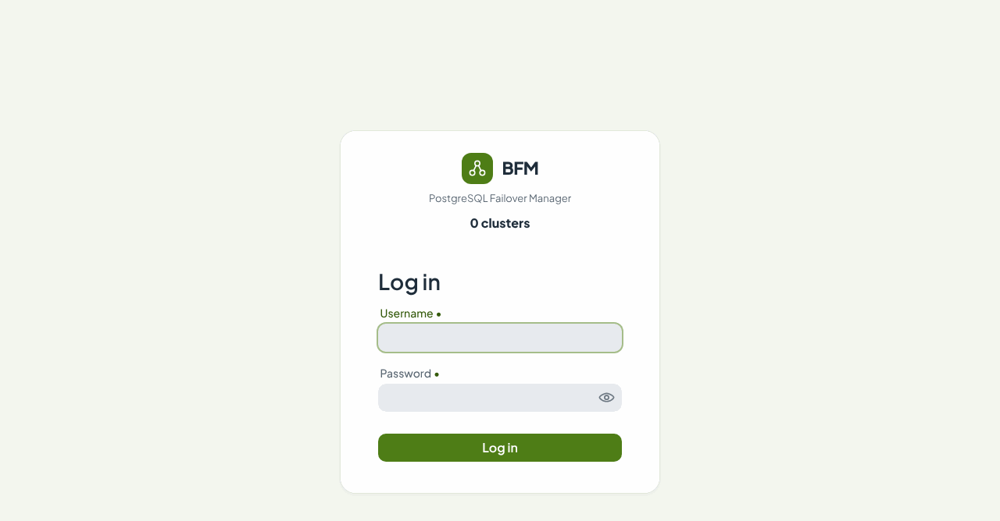

There are two roles:

| Role | Can |
| --- | --- |
| **ADMIN** | everything: switchover, rejoin, re-initialize, start as primary, the cluster switches, acknowledging role changes, mail settings, adding clusters and nodes, detaching |
| **VIEWER** | look at every page; buttons that change something are not offered |

Every change is written to the cluster's event log with the user's name.

The **header** is the same on every page:

- the **cluster switcher**: pick a cluster, or type to find one;
- the cluster's **environment** (production is red, and production pages carry a red line at the top) and its
  **health**;
- **Fleet**: how many clusters are healthy and how many need attention;
- **Watchers**: how many watchers are in contact and which one leads (*standalone* with one watcher);
- your user and role, the light / dark switch, and sign out.

The **side menu** has the pages for every cluster (Fleet, Hosts, Agent certificates, Add cluster) and, under the
chosen cluster's name, the cluster's own pages. Every page has its own address (`/c/erp/replication`), so a link
can be shared.

---

## Fleet: every cluster at a glance

The first page. One line per cluster, the worst first.

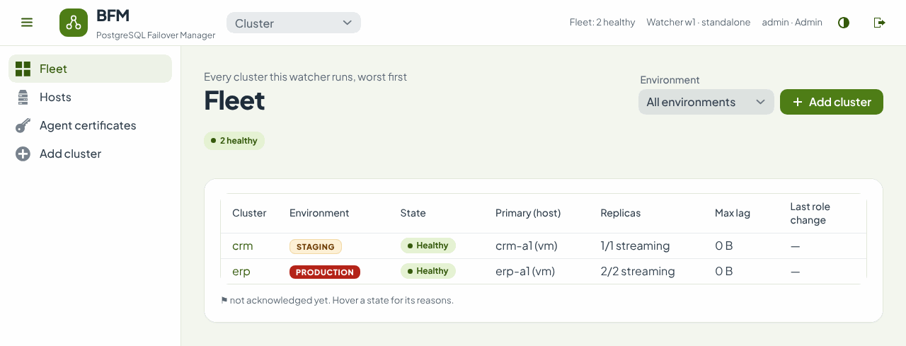

| Column | Shows |
| --- | --- |
| Cluster | the name; opens its Overview |
| Environment | production, staging, test, … |
| State | Healthy, Degraded, Primary down, …; hover it for the reasons |
| Primary (host) | the node that is primary now, and its server |
| Replicas | how many replicas stream, of how many |
| Max lag | the replica furthest behind |
| Last role change | the last failover or switchover; ⚑ until an admin acknowledges it |

The environment filter narrows the list. *Add cluster* starts the wizard; a cluster that is half way through the
wizard is listed under *Being created* with *Continue*.

---

## Cluster overview

Everything about one cluster on one page.

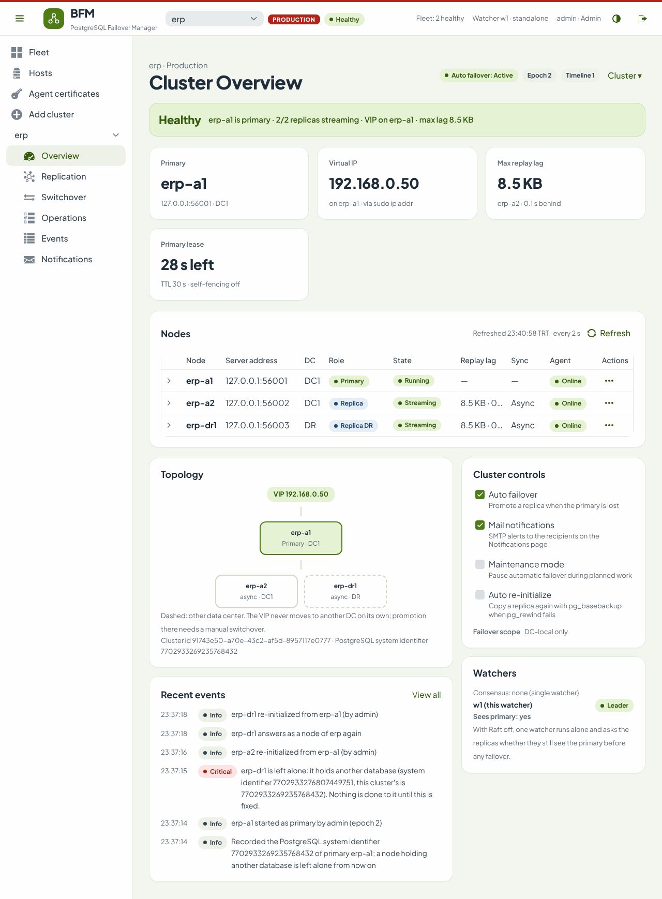

From the top:

- **The health line**: *Healthy* and why in a sentence — who is primary, how many replicas stream, where the
  VIP is, the largest lag. When something is wrong it says what, node by node.
- **Primary**, **Virtual IP**, **Max replay lag** and **Primary lease** cards. The lease is how long the primary
  may stay primary without hearing from the watchers; with self-fencing on, a primary whose lease runs out
  stops itself.
- **Nodes**: role, state and for how long, replay lag, whether its agent answers. The arrow opens a node's details;
  **•••** opens its [actions](#node-actions). Two columns are choices (admins):
  - **Sync**: commits wait for the checked replicas; next to the box, what PostgreSQL reports (*Sync*, *Async*).
    Checking a box opens a popup: *Quorum* (commits stop waiting 10 seconds after too few of the checked
    replicas stream, so writes never stop) or *Strict* (commits keep waiting: writes stop rather than lose a
    commit, and automatic failover promotes only a replica that has every commit), and with two or more replicas
    how many of them each commit waits for. The popup shows the `synchronous_standby_names` BFM writes on every
    node. On the primary's row the box applies once it is a replica again.
  - **Auto failover**: whether automatic failover may promote the node. A node left unchecked stays a replica
    when the primary fails (a manual switchover to it is still possible); with no node checked there is no
    automatic failover. Clearing the last one warns first.
- **Auto-refresh** next to *Refresh*: how often the page reloads its data in this browser (off, 5, 10, 30 or 60
  seconds; 30 by default). The watcher's own checks of the nodes do not change with it.
- **Topology**: the VIP and the replication tree; dashed boxes are in another data center.
- **Cluster controls** (admins):

| Switch | What it does |
| --- | --- |
| Mail notifications | send this cluster's alerts |
| Maintenance mode | for planned work: the watcher keeps watching and alerting, but starts no failover |
| Auto re-initialize | when a former primary cannot be rewound, rebuild it with `pg_basebackup` without asking |

  Maintenance on or auto re-initialize on asks first, and so does maintenance off while the primary is down (it
  would start a failover at once). Under the switches: which nodes automatic failover may promote, and how commits
  wait for replicas, with *Change…* to switch between quorum and strict or change how many replicas a commit
  waits for. A banner says when strict replication makes commits wait, or when quorum replication dropped to
  asynchronous.

- **Watchers**: each watcher, whether it leads, and whether it still sees the primary.
- **Recent events**, with a link to all of them.

On a cluster made in the console, the **Cluster ▾** menu in the title row has *Add node…* and *Detach…*
([below](#adding-a-node-removing-a-node-detaching-a-cluster)).

---

## Replication

Both sides of the stream.

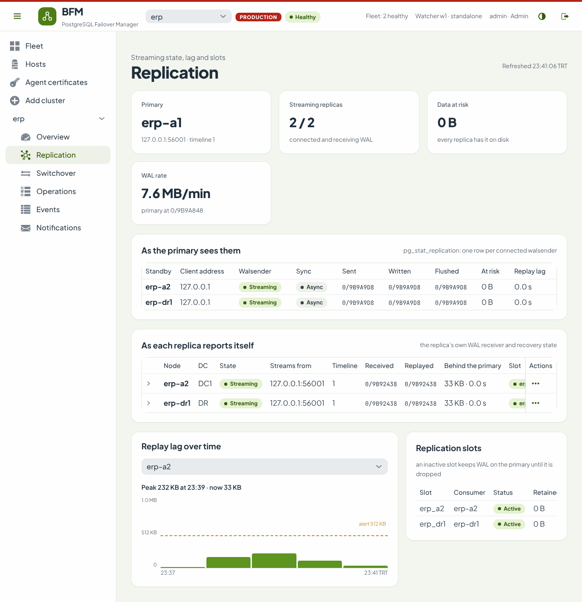

- **As the primary sees them**: one line per connected replica from `pg_stat_replication` — sent, written,
  flushed, and *At risk*: what a crash of the primary would lose from that replica right now.
- **As each replica reports itself**: its own receiver and recovery state, where it streams from, its timeline,
  received and replayed positions, how far behind it is, its replication slot.
- **Replay lag over time**: the last hour for the chosen replica, with its peak and the alert threshold.
- **Replication slots**: every slot on the primary and the WAL it holds. A slot nobody uses keeps WAL on the
  primary until it is dropped; an admin can drop an inactive slot that belongs to no node.

---

## Switchover

A planned change of primary: for maintenance on the primary's host, or to move the primary back.

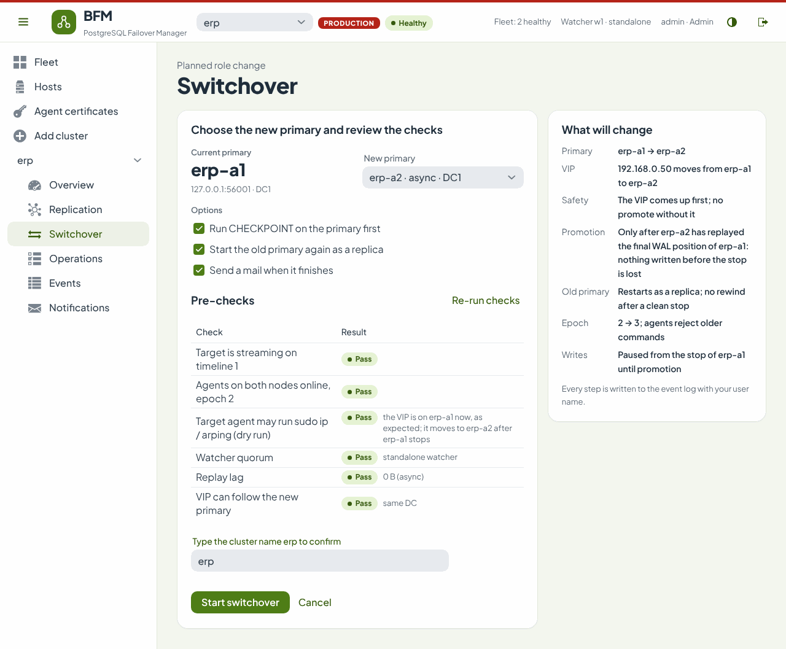

1. Choose the **new primary**.
2. Read the **pre-checks**: the target streams on the primary's timeline, both agents answer, the target may run
   the VIP commands, the watchers agree, the lag is small. *What will change* lists every step in plain words.
3. Type the **cluster's name** and *Start switchover*.

The steps then run one by one, each with its result and duration. Nothing written before the stop is lost: the
new primary is promoted only after it has replayed the old primary's last WAL position, and only after it holds
the VIP.

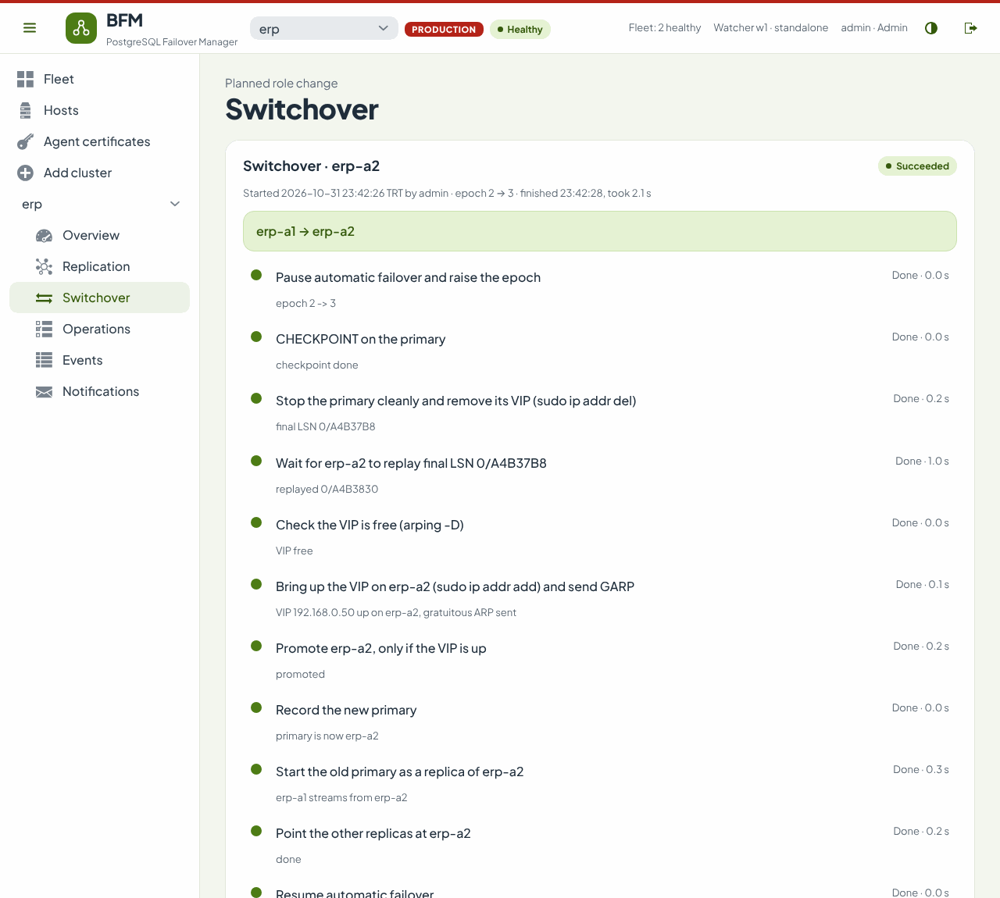

Afterwards the Overview shows the role change until an admin acknowledges it:

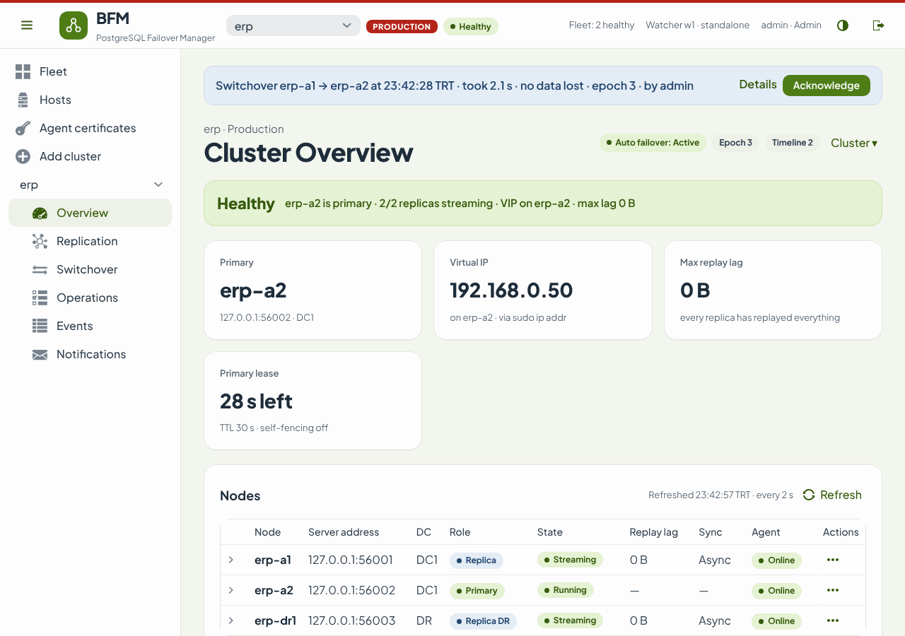

If the VIP cannot be brought up on the target, nothing is promoted: the target stays a replica and the old
primary starts again with its VIP.

---

## When the primary fails

The console changes as soon as the primary stops answering. Within seconds:

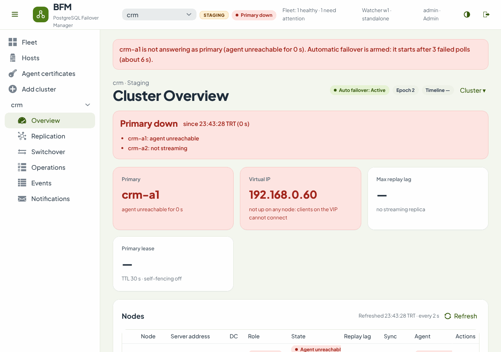

- a red banner names the node, how long it has been silent and that **automatic failover is armed**, with
  how many failed polls it waits for;
- the health line turns **Primary down** and lists the reasons;
- the VIP card says whether clients can still connect.

When the watcher fails over it confirms first that the replicas no longer reach the primary either, raises the
epoch (agents then refuse every older command), brings the VIP up on the best replica and promotes it — only once
the VIP is up. The banner then tells what happened, how long it took and whether any data was lost:

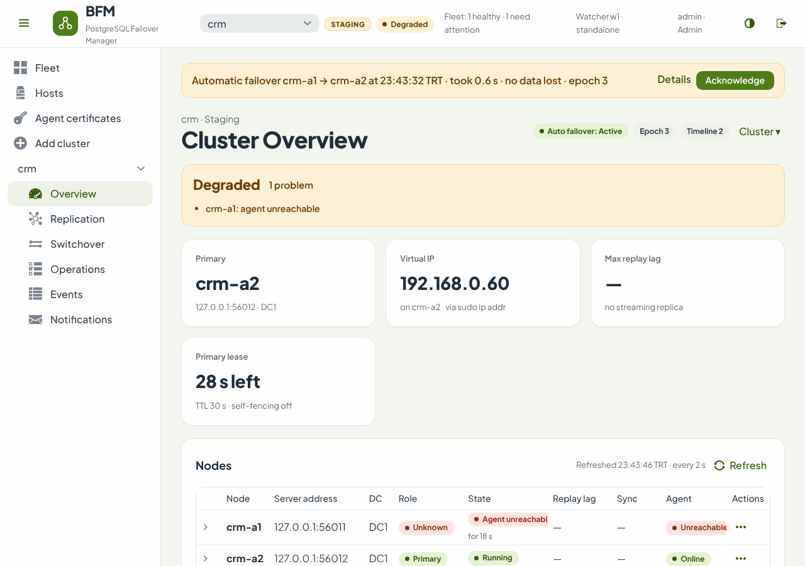

**If failover does not start**, the banner says why — automatic failover is off, maintenance mode is on, no
replica is close enough, the only replica is in another data center — and offers the switch that starts it when
that is the reason. A replica in another data center is never promoted on its own: that is a decision for a
person, with a switchover.

**When the old primary comes back** it is not started as a primary. Its node shows *Stopped*; an admin rejoins it
from its menu (*Rejoin (pg_rewind)…*) and it streams from the new primary again. If `pg_rewind` is not possible,
*Re-initialize…* rebuilds it.

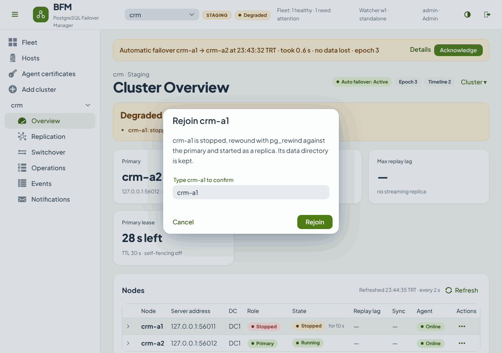

**Acknowledge** the banner once the team has seen it; the Fleet page keeps the ⚑ until then.

---

## Node actions

The **•••** menu of a node:

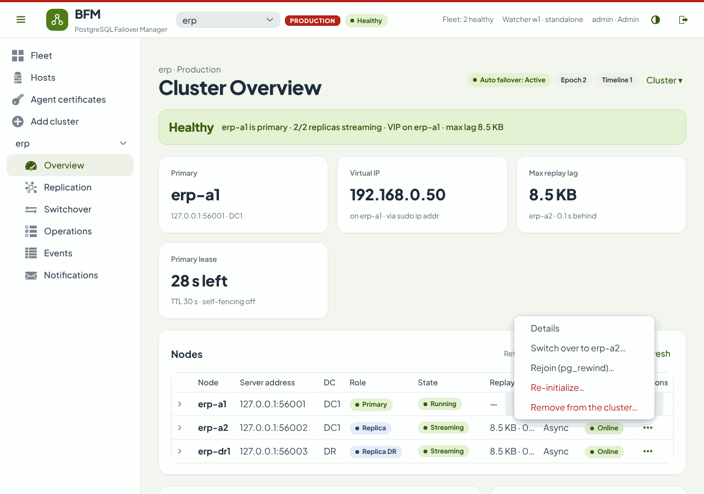

| Action | When | What happens |
| --- | --- | --- |
| Details | always | the node's full state from its agent |
| Switch over to … | a healthy replica | opens [Switchover](#switchover) with this node chosen |
| Rejoin (pg_rewind)… | a stopped or diverged former primary or replica | stops it, rewinds it against the primary, starts it as a replica; its data directory is kept |
| Re-initialize… | a replica that cannot be rewound, or a node holding another database | moves the data directory aside and copies the primary with `pg_basebackup`; takes as long as the copy |
| Start as primary… | no node runs as primary | starts this node as the cluster's primary (the node with the newest data, after an outage of every node) |
| Remove from the cluster… | a cluster made in the console | the watchers stop polling it and its agent forgets the cluster; PostgreSQL keeps running |

Every action that changes something asks you to type the node's name first, and runs as an operation with its
own steps on the Operations page.

---

## Operations and events

**Operations** lists what ran on this watcher since it started — switchovers, failovers, rejoins, re-initializes —
with each step, its duration and its result.

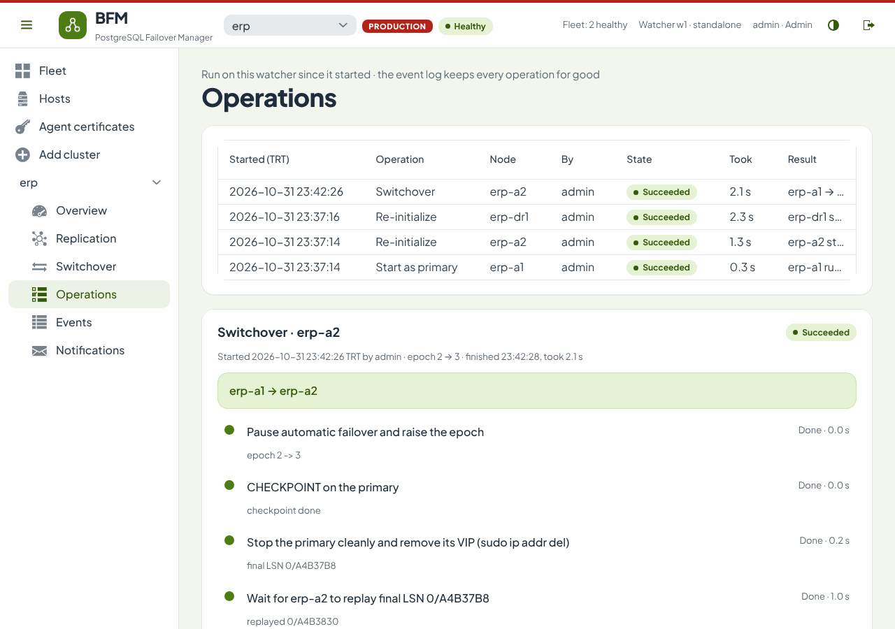

**Events** is the cluster's permanent log: role changes, nodes going down and coming back, switches turned, who
did what. Filter by severity or text (`erp-a2`); a line opens to its full report.

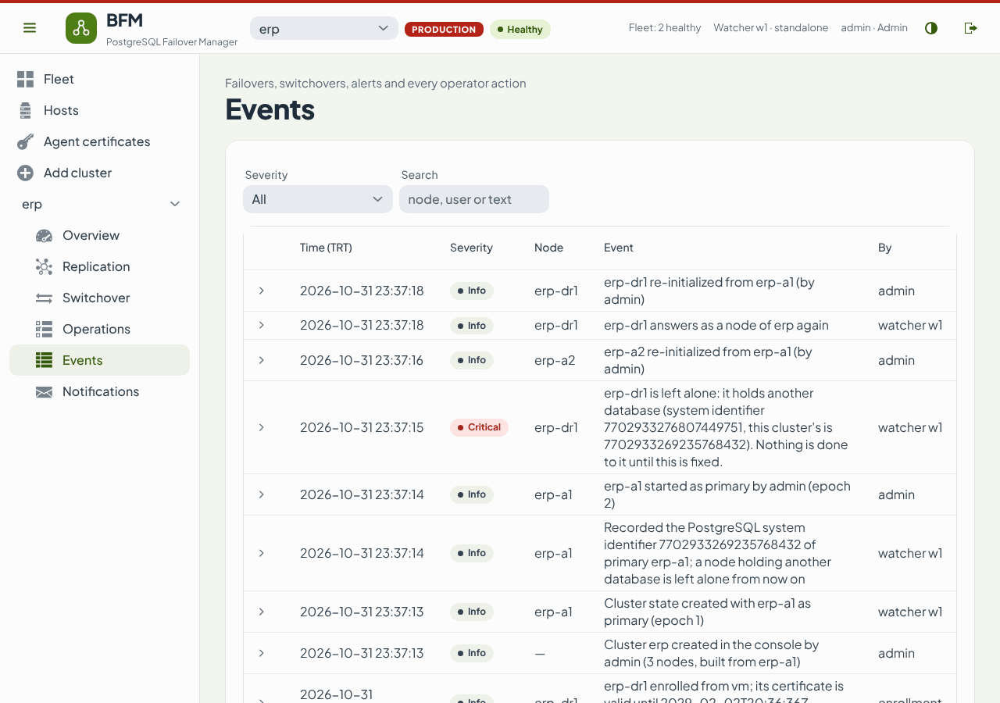

---

## Mail notifications

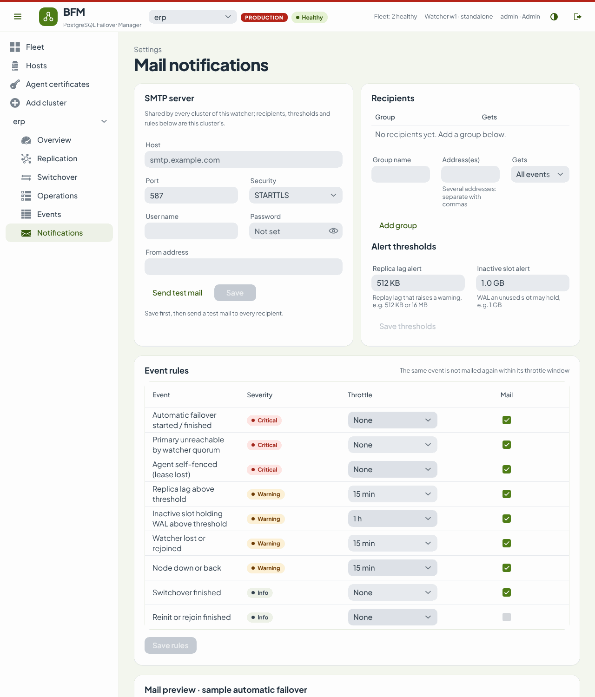

- **SMTP server**: one for every cluster of this watcher. The password is stored encrypted and never shown again.
- **Recipients**: groups of addresses, each getting all events, critical ones only, or role changes.
- **Alert thresholds**: replica lag and the WAL an inactive slot may hold (`512 KB`, `1 GB`).
- **Event rules**: which events send mail and how often the same one may repeat.
- *Send test mail* after saving, to every recipient.

Recipients, thresholds and rules belong to the cluster; the SMTP server is shared.

---

## Adding a cluster

*Add cluster* (admins) makes a cluster without touching `watcher.yml`. It has six steps; a draft is kept until it
is created or discarded, so you can stop and continue later from the Fleet page.

**1. Basics**: the name (it is part of the addresses and is typed to confirm switchovers), the environment, where
automatic failover may go (only within the primary's data center, or any), self-fencing (recommended with three
watchers). *Advanced* has the poll interval, how many failed polls start a failover, and the lag above which a
replica is not promoted automatically.

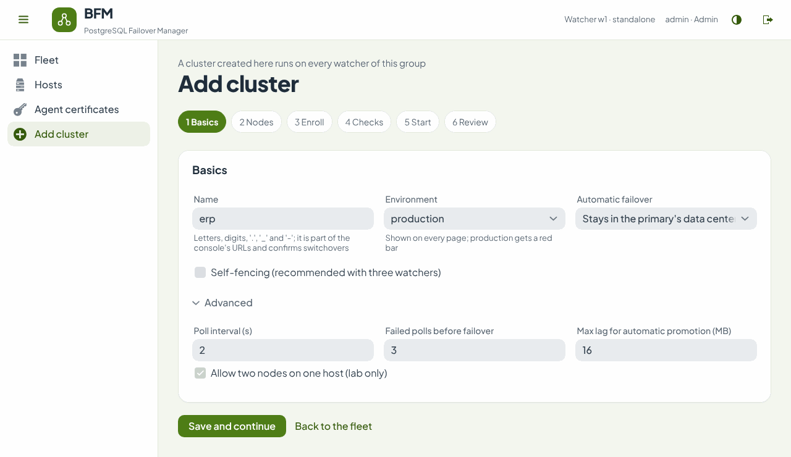

**2. Nodes**: at least two, each with its name, the agent's address (`https://host:8008`), PostgreSQL's address
and port (the node's own, never the VIP), its data center and priority.

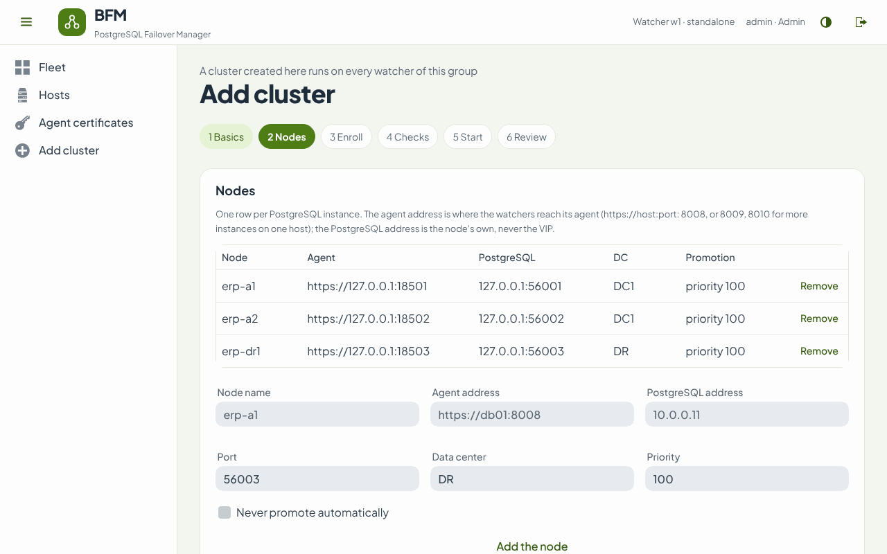

**3. Enroll**: one command per node, to run as root on that node's host after installing the `minipgagent`
package ([install-rpm.md §4](install-rpm.md#4-install-the-agent-on-every-database-host)). A command works once, for
that node, for 30 minutes.

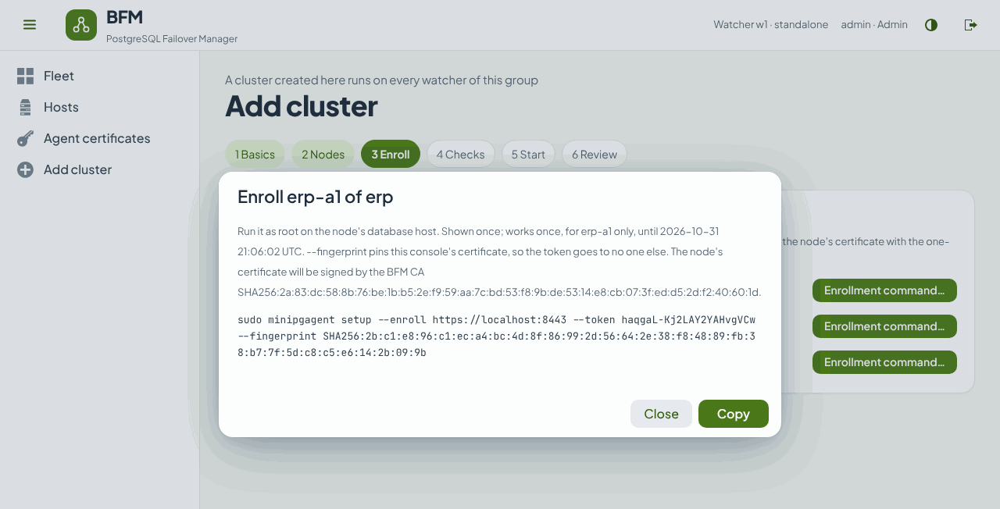

The page follows each node until its agent answers:

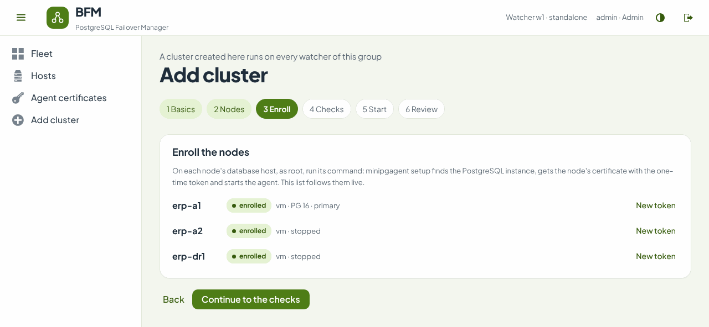

**4. Checks**: across the nodes, then each node's own settings. A red line blocks creation; a yellow one says
what to do after it. In the example, two nodes are fresh `initdb`s ("hold another database"): *Build* rebuilds
them in step 5.

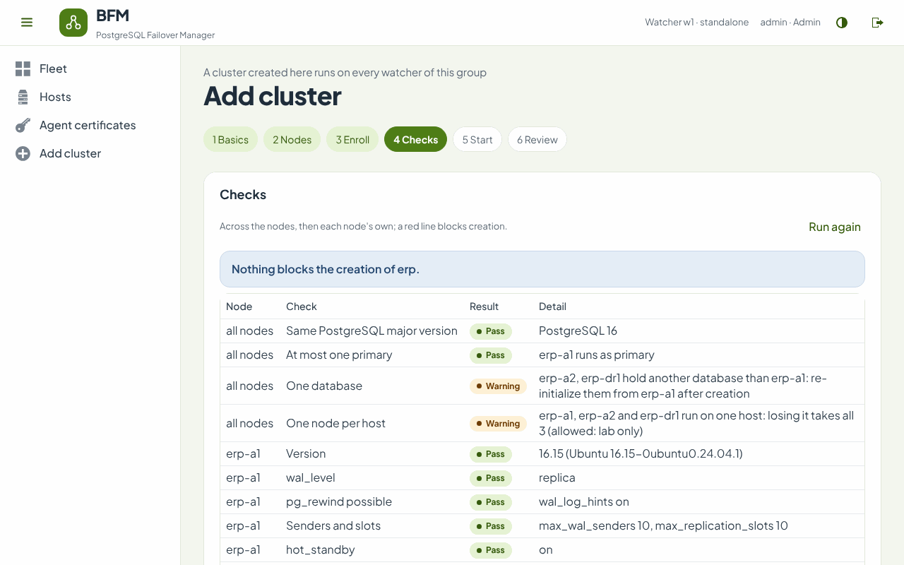

**5. Start**: *Adopt* records the node that already runs as primary and keeps the replicas as they are. *Build*
starts the chosen node as primary and re-initializes every other node from it.

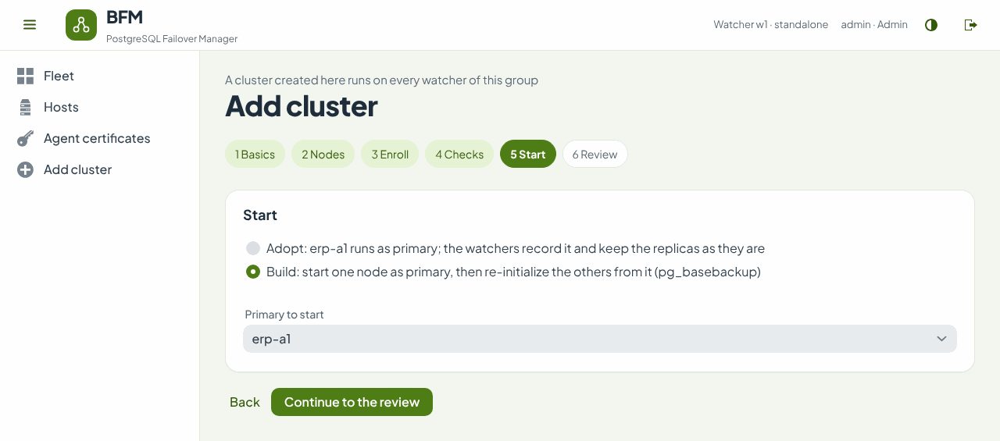

**6. Review**: everything once more; type the name and *Create the cluster*. With *Build*, the Operations page
opens and shows the primary starting and each replica being copied:

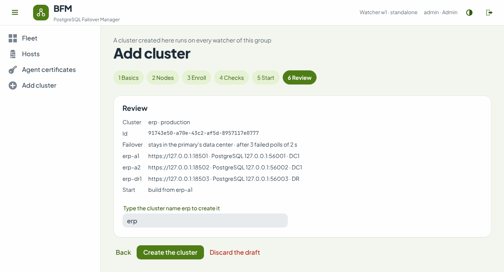

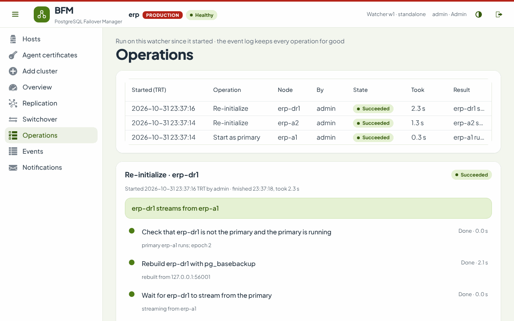

The cluster then runs on every watcher of the group. Clusters can still be defined in `watcher.yml` instead;
those are changed there, and their Cluster menu says so.

---

## Adding a node, removing a node, detaching a cluster

On a cluster made in the console, the **Cluster ▾** menu of the Overview:

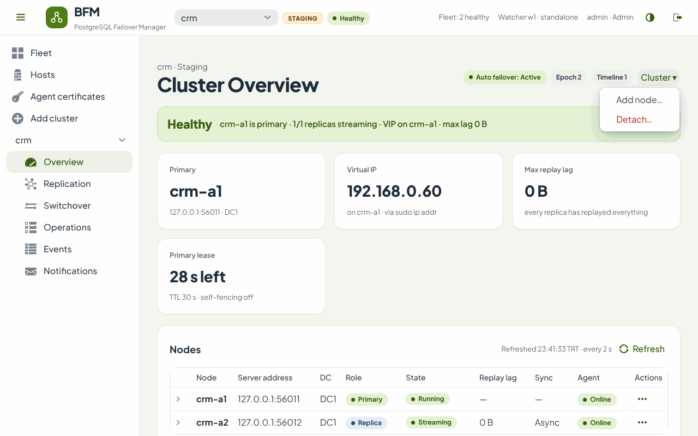

**Add node…** asks for the node's addresses, adds it and shows its enrollment command. Once its agent runs, the
node follows the primary; if it holds another database (a fresh `initdb`), *Re-initialize* it from its menu.

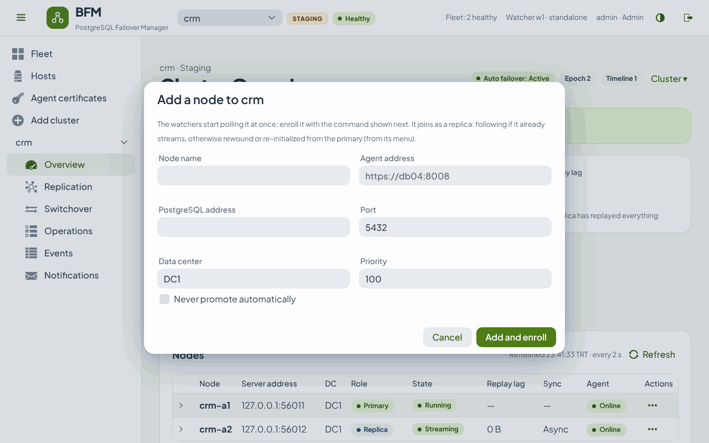

**Detach…** takes the cluster away from BFM: automatic failover is paused, the watchers stop, the primary gets a
last lease that never fences (it keeps running even with self-fencing), and every agent forgets the cluster.
PostgreSQL keeps running on every node and the event log stays. Afterwards run `minipgagent remove` on each host,
or add the nodes to another cluster.

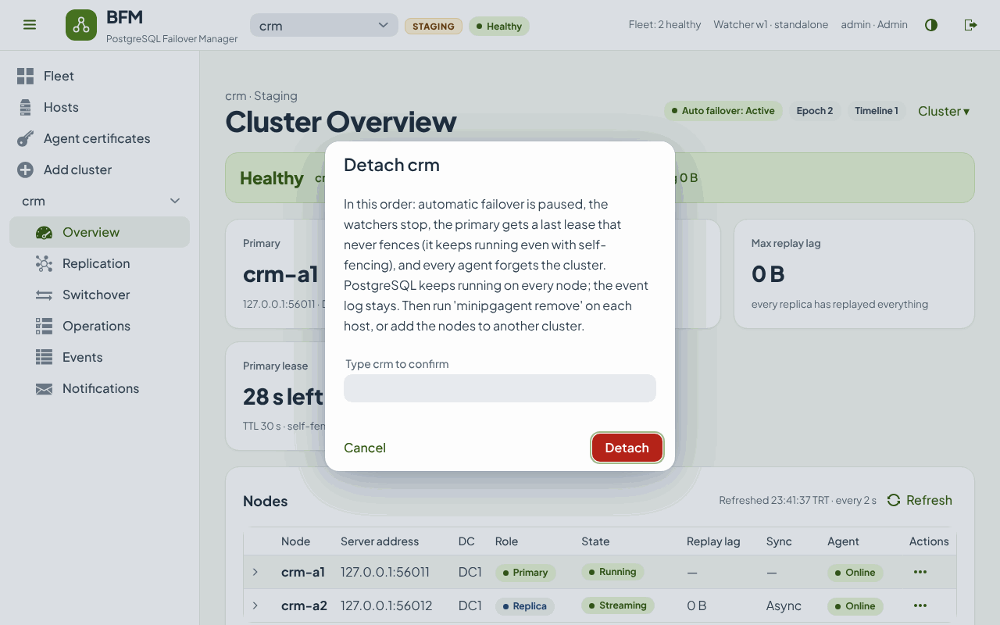

A single node is taken out with *Remove from the cluster…* in its own menu.

---

## Hosts

Which instances of which clusters run on each server, as the agents report it (`/etc/machine-id`). A cluster with
two nodes on one server is marked: losing that server would take both.

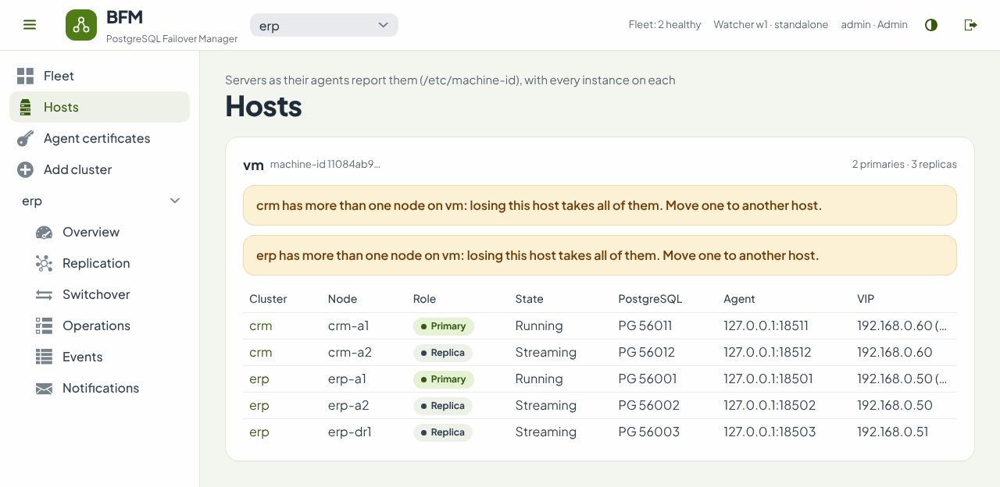

---

## Agent certificates

The CA that signs the agents' certificates (its key is kept in the watchers' shared state, encrypted with
`secret.key`), and an *Enrollment command…* for every node — to enroll a node again, for example after its host
was rebuilt. A CA made elsewhere (`bfm-make-certs`) can be taken over here.

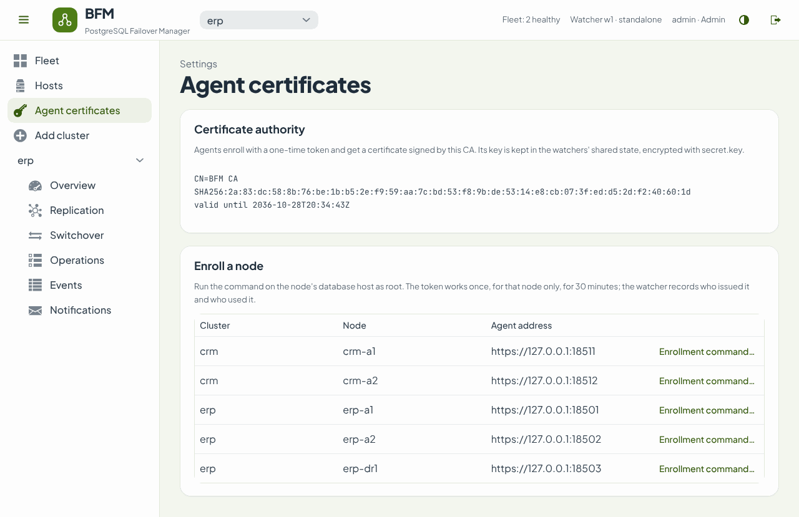

---

## Three watchers

With three watchers, one leads and acts for every cluster; the other two watch, keep the same state and take over
if the leader goes. The header shows *Watchers 3/3 · leader w1*. Every watcher's console shows the same
clusters; operations and the wizards run on the leader, and a follower's pages link to it ("Open the leader's
console").

---

## Dark mode and phones

The console follows the operating system's light or dark setting; the ◐ button in the header overrides it.

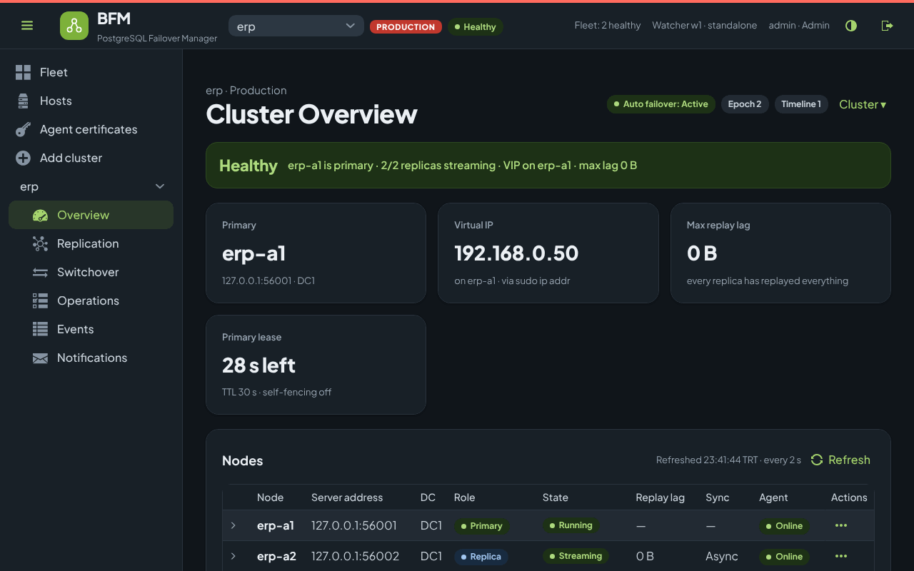

On a phone the side menu folds away, node tables become cards, and the most important facts stay at the top.

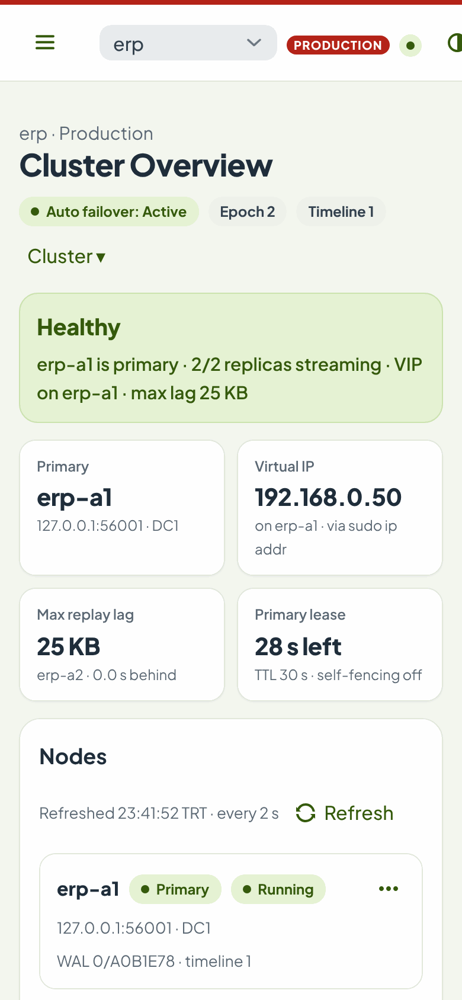

---

## Health states

| State | Meaning |
| --- | --- |
| **Healthy** | the primary runs, every replica streams, the VIP is on the primary, nothing above the thresholds |
| **Degraded** | the primary is fine but something needs attention: a replica down or lagging, an agent unreachable, an inactive slot holding WAL; the reasons are listed |
| **Primary down** | the primary does not answer; automatic failover is armed (or the banner says why not) |
| **Primary unverified** | the watcher reaches the wrong agent or the wrong database at the primary's address (*Wrong identity*); nothing is done until it is fixed, and no failover starts on a wrong reading |
| **No primary** | no node is recorded as primary, for example after every node was down; *Start as primary* on the node with the newest data |
| **Starting** | the watcher has just started and has not read the cluster yet |

Node states in the tables: *Running* (primary), *Streaming* or *Not streaming* (replica), *Stopped*, *Busy: …*
(a `pg_basebackup` or `pg_rewind` runs there), *Agent unreachable*, *Wrong identity*, *Fenced* (BFM stopped it to
keep it from acting as a second primary; its details say why).
